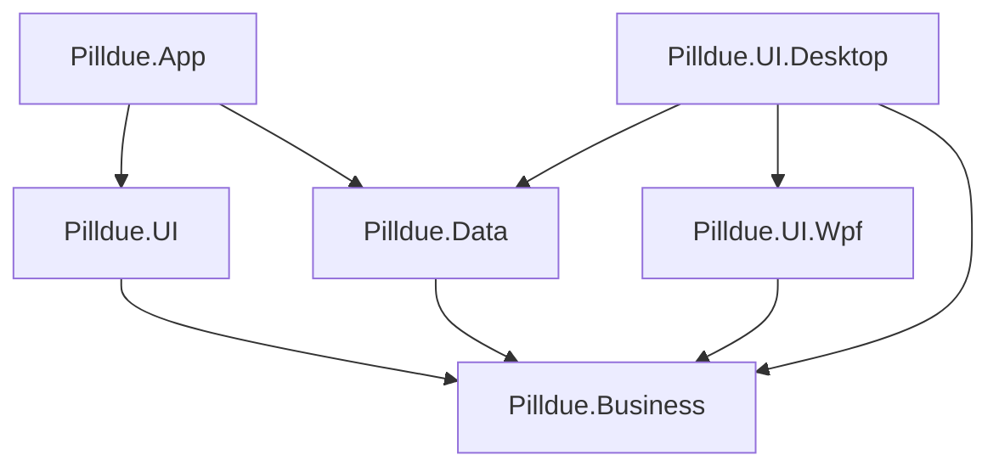

# Architecture

## Product intent

Pilldue helps you track medications against a **monthly refill day**, package-based stock, and prescription validity — so you know what to buy before the next (or second) refill and when to renew the prescription.

**Audience:** personal tool only. One local instance per person; never multi-tenant. See [use-cases.md](use-cases.md) for v1 flows.

## v1 scope

### In

- Per-med refill day = prescription start day-of-month (no global default refill day)
- Med definition: package size, prescribed package count, pills per dose, dose interval (days), stock, prescription window (~6 months)
- Queries: stock vs next refill day; short list; need-extra-packages for second refill day
- Refill by package count (logged as today); skip-dose stock bump; calendar (today → latest second refill; red stock-outs; assume first restock)

### Out

- Pharmacy / Rx numbers / doctor contacts
- Dose reminders / push
- Multi-user, cloud, sync accounts

## Stack

| Topic | Choice |
|-------|--------|
| Delivery | Local small published exe |
| UI | Spectre.Console |
| Persistence | **SQLite via EF Core** (migrations for schema) |
| Config | File (UI language) — not EF |
| .NET | .NET 10 (`net10.0`) |
| Solution | [Pilldue.slnx](../Pilldue.slnx) |

### Schema and data access

- Use **EF Core** + SQLite in `Pilldue.Data` for tables and repository implementations.
- Manage schema with **EF migrations**; apply on startup (or explicit migrate in tests with temp DB) via `PilldueDbBootstrap.MigrateAsync`.
- Do **not** use Dapper or hand-rolled ADO for v1.
- Config file stays a simple file store (JSON or similar), separate from EF.

**Default SQLite path:** `%UserProfile%/Pilldue/pilldue.db`, with `config.json` in the same folder (see `SqliteDatabasePaths`). The terminal host and the WPF host both open that location through `PilldueComposition`. On startup, if the profile folder has no database and `%LocalAppData%/Pilldue/pilldue.db` exists, that database and `config.json` are moved. Design-time `pilldue-design.db` stays out of the user folder. Tables: `medications`, `refill_events`, `skip_dose_events`, `missed_dose_events`.

## Solution layout and dependencies

```
Pilldue.slnx
src/
  Pilldue.Business/    # domain, ports, pure logic, app services, shared UI catalogs
  Pilldue.Data/        # EF Core + SQLite (migrations) + config file + composition helpers
  Pilldue.UI/          # Spectre.Console screens (Business only)
  Pilldue.UI.Wpf/      # WPF screens (Business only)
  Pilldue.UI.Desktop/  # WPF host / composition root (Windows-only)
  Pilldue.App/         # terminal host / composition root
```

Target dependency direction:



- Ports and entities live in **Business** (plus in-memory fakes for tests)
- English and Serbian Latin UI catalogs live in **Business** (`UiLocalizer`) so both screen projects can read them. WPF does not reference Spectre.Console
- **Data** implements ports with **EF Core + SQLite** (and config file for app settings) and exposes `PilldueComposition` for hosts
- **UI** is a Spectre library that calls `IPilldueApp` only
- **UI.Wpf** is the WPF screen library. It references Business only and calls `IPilldueApp` for list, add, refill, and remove. It does not reference Data, EF Core, SQLite, or SQL
- **App** is the terminal composition root: opens SQLite, migrates, passes `IPilldueApp` into the UI
- **UI.Desktop** is the Windows WPF composition root: opens the session with `PilldueComposition` and passes `IPilldueApp` into the WPF screens

Shared planning formulas live in `RefillCalendarRules` (day clamp, packages-to-buy, inclusive last-covered rule, prescription end = start + duration months). Full query implementations are tracked in business issues C1–C9.

## Tests

```
tests/
  Pilldue.Data.Tests/
  Pilldue.Business.Tests/
  Pilldue.IntegrationTests/   # multi-step actions → assert; no UI
```

## Docs

- [Use cases](use-cases.md)
- [Getting started](getting-started.md)
- [Development](development.md)
- [Improvements](improvements.md)
